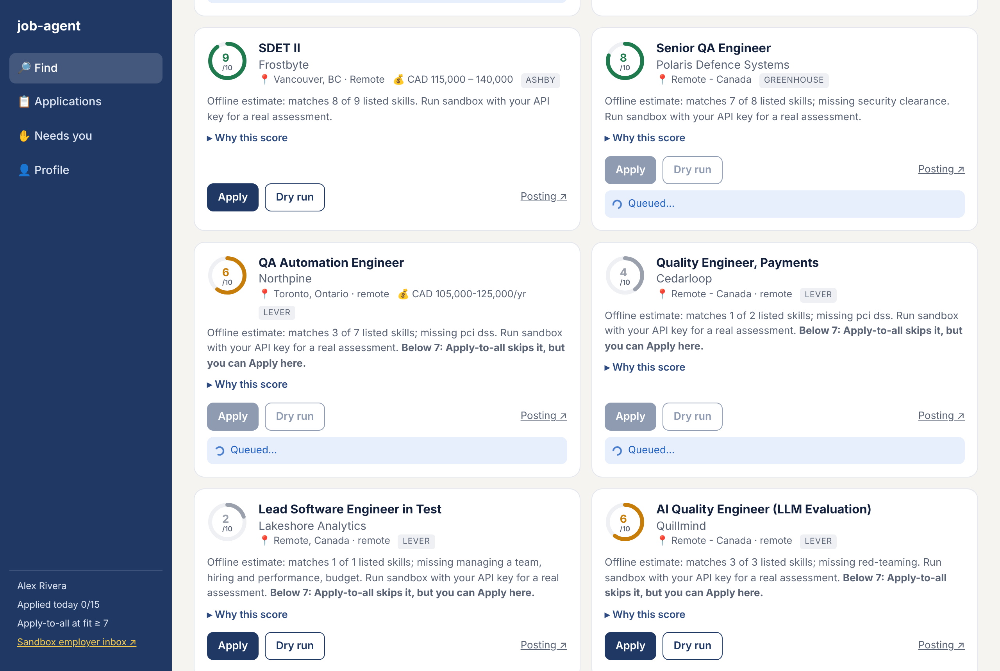
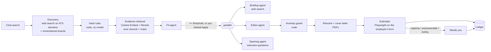
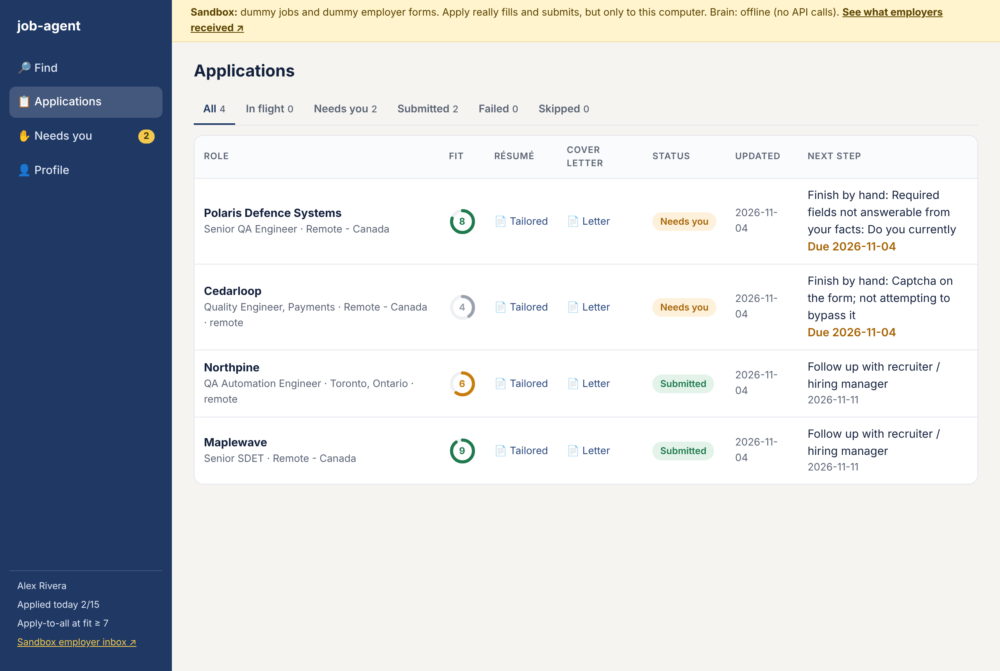
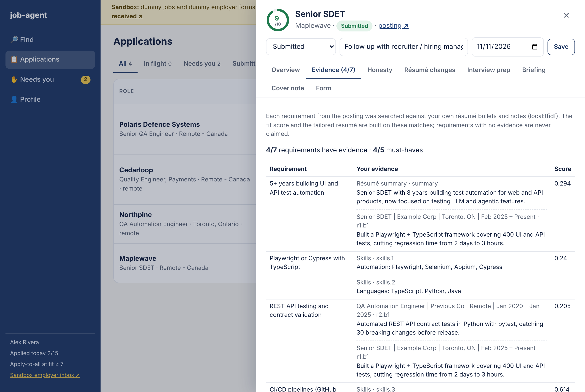
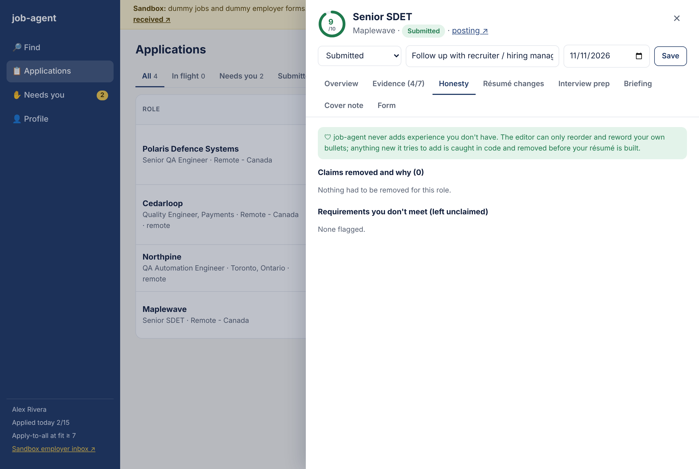
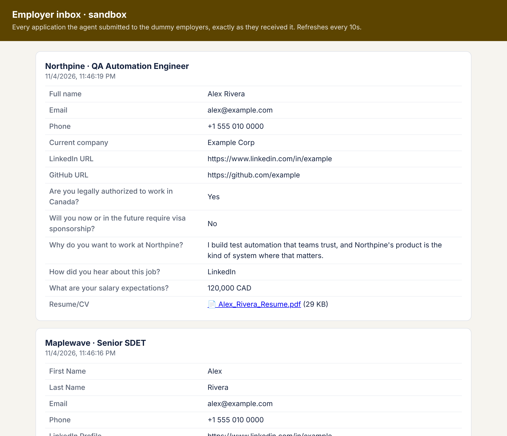

# job-agent

**A multi-agent system that finds jobs, tailors an application from evidence, and submits it through the employer's own form, with guardrails in code so it never claims experience you don't have.**

TypeScript · Claude or Cohere Command · Cohere Embed + Rerank (RAG) · Playwright · zod · 67 tests + an eval harness in CI



## What it does

You type *"SDET or QA automation jobs, remote in Canada"*. The system:

1. **Finds** open postings on Greenhouse, Lever and Ashby and drops the ones that don't fit your rules (location, work mode, contract, pay floor, already applied), saying how many it dropped and why.
2. **Retrieves evidence.** Every requirement in the posting is searched against your own résumé bullets and notes (Cohere Embed → cosine top-k → Cohere Rerank). Requirements with no evidence are marked, not papered over.
3. **Scores fit** from that evidence map, lists gaps, and suggests an honest plan to close them.
4. **Tailors** the résumé and cover note: the editor can only reorder and reword your own bullets, and a code-level honesty guard removes anything new (tools, numbers, scope claims) before the PDF is built.
5. **Applies** by driving the employer's real form in a browser: profile answers first, a constrained model only for leftovers, and it stops for you on captchas or any required question it can't answer truthfully.
6. **Tracks** everything: status per role, the exact answers and documents that went out, interview prep, follow-up dates.

## Architecture



Each agent has its own prompt, inputs and typed output (JSON-schema structured output, validated again with zod). The fit agent never sees the cover note; the editor never sees the briefing. A screener that's also selling you the job scores generously, and a writer that also judges fit writes defensively, so they're kept apart.

## Design decisions

| Decision | Why |
|---|---|
| **Guardrails live in code, after the model** | Prompts can be talked around. Hard rules run before any model call; the honesty guard runs after the editor and checks every rewrite against your résumé (whole-word terms, numbers, scope/scale words). Eval: 100% of invented tools/numbers caught, 0% of legitimate edits rejected. |
| **RAG over your own evidence, not keyword overlap** | The fit score and the tailored résumé cite which of your bullets support each requirement. "No evidence" is a first-class result, shown in the UI and never claimed. |
| **Model only where judgment is needed** | Requirement extraction, location filtering, standard form fields and the guard are deterministic code. Models do fit judgment, rewriting, interview questions and the free-text answers profile data can't cover. |
| **Abstain instead of guess** | Unknown form answers come back `UNKNOWN`; any unanswered *required* field stops submission and puts the role in a "Needs you" queue with the exact question. |
| **Provider-agnostic** | `JOB_AGENT_PROVIDER=cohere` runs every agent decision on Cohere Command; Claude remains for web search. Retrieval uses Cohere Embed/Rerank when a key is set and an offline TF-IDF embedder otherwise. |
| **A sandbox to test the whole thing safely** | `npm run sandbox` serves 17 fictional postings through the real Greenhouse/Lever/Ashby API shapes and employer forms that validate like real ones, plus an "employer inbox" showing exactly what was received. It found three real bugs before any real application went out. |
| **Failures are recorded, not lost** | Every failure after the posting is read becomes a ledger row with a plain-language reason, the fit score and documents kept. |

## Evals

`npm run eval` runs the deterministic suites (no keys, no network) and CI fails if any metric drops below its floor. Latest numbers are in [evals/RESULTS.md](evals/RESULTS.md).

| Suite | Setup | Result |
|---|---|---|
| Honesty guard | 26 fabricated + 13 legitimate edits | **100%** invented tools/numbers caught · **96%** of all fabrications · **0%** legit edits rejected |
| Requirement extraction | 17 postings | **100%** precision / recall |
| Evidence retrieval, offline TF-IDF | 15 requirements with evidence + 6 without | recall@3 **87%** · paraphrases **60%** · "no evidence" reported correctly **100%** |
| Evidence retrieval, Cohere Embed v4 + Rerank v3.5 | same | hit@1 **93%** · recall@3 **100%** · paraphrases **100%** · "no evidence" reported correctly **100%** |
| Form answers (real browser) | 16 sandbox employer forms | **100%** known fields correct · **100%** unanswerable questions left blank · **100%** captcha/unanswerable runs stopped for a human |
| Fit scoring (Claude) | 8 labelled postings | **88%** in the expected band · **74%** of pairs ranked in the right order |

What the evals found and what's still open:

- The first run showed the guard missed **scope inflation** ("Managed the team that built…", "company-wide", "used by 2 million people"). A scope/scale rule fixed those; held-out cases written afterwards check it generalises (3 of 4 caught). *"Became the go-to expert for LLM testing"* still gets through, and is reported rather than hidden.
- Offline retrieval handles shared vocabulary but misses paraphrases ("make sure our apps work on phones" → the Appium bullet). Cohere Embed + Rerank finds all of them: paraphrase recall@3 went from 60% to 100%.
- But retrieval finding the right bullet isn't the same as the system using it. With Cohere, 5 of 15 requirements have the right bullet ranked first yet score under the 0.35 "supported" threshold (rerank scores 0.05 to 0.17), so they're shown as unsupported. That's the safe direction for an honesty-first tool, but too strict. Next step: log scores for the no-evidence cases too and calibrate the threshold on both sides instead of guessing.
- Fit scoring over-scores one posting where mentoring and two nice-to-haves are missing (8 instead of mid).
- The fit and Cohere suites call paid APIs, so they're opt-in rather than in CI. Fit labels are the maintainer's, on synthetic postings: a direction check, not a benchmark.

## Screens

| | |
|---|---|
|  |  |
| **Applications**: live status per role, tailored résumé and cover letter, filter tabs | **Evidence**: each requirement, the bullets that support it, or "no evidence" |
|  |  |
| **Honesty**: claims removed and why, requirements left unclaimed | **Sandbox employer inbox**: exactly what a submission sent |

## Project layout

```
src/
  agents/      filter (fit), editor + honesty guard, briefing, sparring, ledger, hard rules
  rag/         evidence chunks, requirement extraction, Cohere Embed/Rerank clients, local embedder, retriever
  submit/      form scanning, answer resolution, submitter
  jobs/        Greenhouse / Lever / Ashby posting APIs
  sandbox/     fictional job market, employer forms + inbox, offline model
  evals/       eval runner (datasets in evals/)
  ui/          local web app server
  providers.ts Claude / Cohere Command
  pipeline.ts  one role end to end
ui/app.html    the web app
tests/         unit, browser end-to-end, sandbox, provider and RAG tests
```

## Guardrails in detail

Rules that must never be broken live **in code**, not in prompts:

| Guard | Where | What it does |
|---|---|---|
| Hard rules | `agents/rules.ts` | Skips contract/temp/fixed-term, non-remote, and postings whose pay tops out under your floor *before* any model call |
| Honesty guard | `agents/editor.ts` | Every rewritten bullet is checked against your base résumé: new tools, tech terms, numbers, or scope/scale claims (led, company-wide, millions…) that aren't already there are removed and listed in the report and the Honesty tab |
| No guessing | `submit/answers.ts` | Form answers come from your profile and answer bank first. Leftovers go to a model that may only use your facts or say `UNKNOWN` |
| Required-field gate | `submit/submitter.ts` | If any required field can't be answered truthfully, it doesn't submit; status becomes `needs_manual` with the exact question |
| Captchas | `submit/form.ts` | Detected and stopped at. Never solved or bypassed |
| Dedupe + daily cap | `agents/ledger.ts` | Never applies to the same posting twice; stops at `dailyCap` per day |
| Demographic questions | `submit/answers.ts` | Always "decline to self-identify" when that option exists |

Every run writes `report.md` with the full table of what went into the form, where each value came from, and what the honesty guard rejected.


## Setup

```bash
npm install
npx playwright install chromium        # or set JOB_AGENT_CHROME_PATH to an installed Chrome
npx tsx src/cli.ts init                 # creates config/profile.yaml, config/resume.md, .env (all gitignored)
```

Fill in `.env` (`ANTHROPIC_API_KEY`, optionally `COHERE_API_KEY`), `config/profile.yaml`, and `config/resume.md` (format shown in `config/resume.example.md`). Put any extra evidence (project write-ups, notes about your work) in `config/evidence/*.md`; each bullet or paragraph becomes retrievable evidence.

## Use

### Chat (main way to use it)

```bash
npm run ui      # http://localhost:3000
```

Type what you want, e.g. *"SDET or QA automation jobs, remote in Canada"*. The bot:

1. turns the message into roles + synonyms, country/cities and work mode,
2. finds open postings with web search restricted to Greenhouse, Lever and Ashby, plus every company board it has seen before (`data/boards.json`, grows with each search),
3. drops wrong location / work mode / contract / under-floor pay / already-applied roles,
4. shows a card per role with a fit score from the filter agent,
5. **Apply** on a card runs the whole pipeline and submits; **Apply to all with fit ≥ 7** queues every good card.

The app has four views:

- **Find**: search box, live “8 found · 5 of 8 scored” progress, match cards with a fit ring, *Why this score* (strengths, gaps, and an honest **To reach 8** plan), Apply / Dry run, and Apply-to-all.
- **Applications**: every role with its tailored résumé and cover letter, live status pills (Queued → Scoring fit → Tailoring résumé → Filling form 8/16 → Submitted), filter tabs (All, In flight, Needs you, Submitted, Failed, Skipped) and **Submit all ready**. Click a row for the drawer: Overview, **Honesty** (claims removed and why), **Résumé changes** (before/after, bullet by bullet), **Interview prep** (graded mock interview), Briefing, Cover note, and the exact Form answers with a screenshot.
- **Needs you**: everything the agent stopped on instead of guessing, with Finish by hand, Retry and Mark as applied.
- **Profile**: what the agent knows about you and the rules it follows.

### Sandbox (try everything on dummy jobs first)

```bash
npm run sandbox             # your profile + resume, real Claude, dummy jobs and employer forms
npm run sandbox -- --offline  # no API key needed; rough keyword scoring
npm run sandbox -- --reset    # start with an empty sandbox ledger and inbox
```

Search returns only fictional sandbox companies; **Apply really fills and submits** their forms, but the
forms are served from your machine. The yellow bar links to the **employer inbox**, which shows every
application exactly as the "employer" received it, with the uploaded resume and cover letter. The dummy
market is built so each case shows up at least once:

| Case | Sandbox posting |
|---|---|
| Submits (Greenhouse / Lever style forms) | Maplewave, Northpine, Aurora Labs, EvalForge, Quillmind |
| Ashby: filled, you click Submit | Frostbyte |
| Captcha: stops and asks you | Cedarloop |
| Required question you can't answer from your facts | Polaris Defence Systems |
| Low fit: skipped by Apply-to-all | Lakeshore Analytics |
| Filtered out of "remote in Canada" | Sunbeam (California, hybrid), Pampa Tech (LATAM), Globex (US), Initrode (contract), Budget Books (pay), Ottawa Tech / Harbour / King West (hybrid) |
| Closed search hit | one Maplewave URL |

Sandbox data lives in `data-sandbox/`, separate from your real ledger. Web search is never called in sandbox.

The UI only listens on localhost. Agents, the browser and your resume all stay on your machine.

### CLI

```bash
# score only: fit 1-10 + gaps
npx tsx src/cli.ts score https://job-boards.greenhouse.io/acme/jobs/123

# safest first run: everything, fills the form, screenshots it, does NOT click submit
npx tsx src/cli.ts run --dry-run https://jobs.lever.co/acme/abc

# the real thing (applies automatically when fit ≥ scoreThreshold and every gate passes)
npx tsx src/cli.ts run https://jobs.ashbyhq.com/acme/uuid
npx tsx src/cli.ts batch jobs.txt       # one URL per line

# interview drill on a prepared role
npx tsx src/cli.ts spar out/2026-11-03-acme-senior-sdet

# the ledger
npx tsx src/cli.ts ledger list
npx tsx src/cli.ts ledger due           # follow-ups owed (7+ days since applying) or next steps due
npx tsx src/cli.ts ledger set 3 interviewing --next "Tech screen" --date 2026-11-10
npx tsx src/cli.ts ledger csv
```

Each job gets a folder in `out/` with `fit.json`, `briefing.md`, tailored resume + cover letter PDFs, `questions.md`, `form.png` (what was submitted), and `report.md`.

## Supported application forms

| ATS | Posting data | Auto-apply |
|---|---|---|
| Greenhouse | public Job Board API (incl. application questions) | yes |
| Lever | public Postings API | yes |
| Ashby | public Posting API | fills only: Ashby flagged an automated submit as spam in testing, so you click Submit |
| Anything else | page text | no: documents prepared, status `needs_manual` |

LinkedIn Easy Apply and Workday are deliberately not automated: both actively block bots and an account ban costs more than a few applications.

## Tests

```bash
npm test
```

67 tests: unit tests (URL parsing, ATS mapping, hard rules, honesty guard, ledger, form answers, local dates), RAG tests (requirement extraction, retrieval, Cohere Embed/Rerank request shapes, vector cache), provider tests (Cohere Command structured output and fallbacks), and end-to-end tests that drive a real browser through local and sandbox employer forms: submit, captcha stop, unanswerable-question stop, Ashby hand-off, dry run, duplicates, daily cap, a browser that won't start, and the ledger surviving a restart.

```bash
npm run eval              # deterministic eval suites → evals/RESULTS.md
npm run eval -- --llm     # + fit scoring with your model key
```

## Limits, honestly

- ATS forms change. Field discovery reads labels the way a screen reader would rather than relying on per-site selectors, but custom dropdown widgets can still fail. Those end as `failed` or `needs_manual` with a screenshot, never as a silent bad submission.
- Greenhouse uses invisible reCAPTCHA on some boards; if it rejects an automated submission you'll see `failed: no confirmation` and should apply by hand.
- The briefing is only as good as what web search finds; it says "not found" rather than guessing names.
